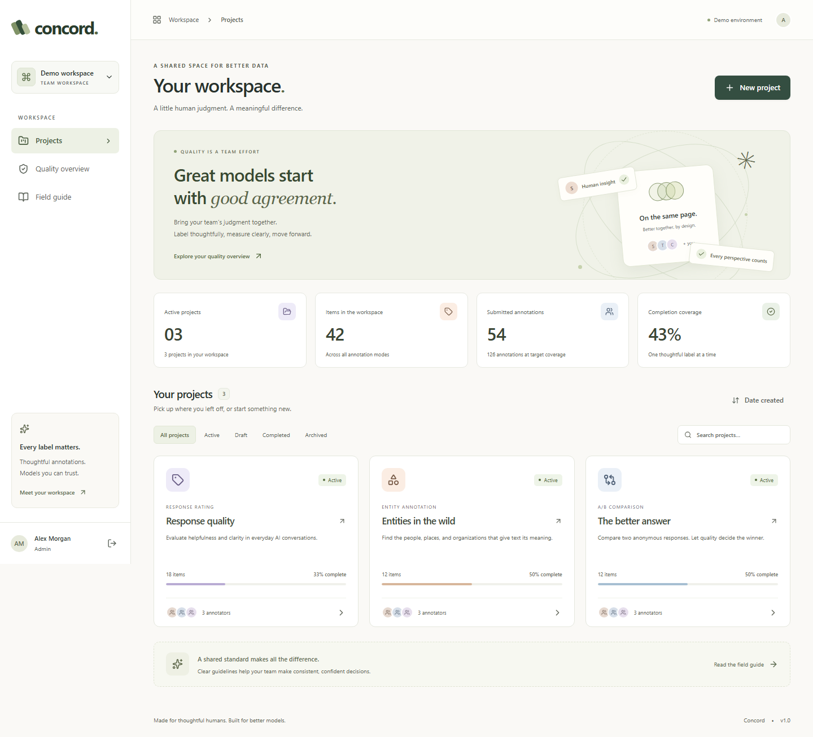
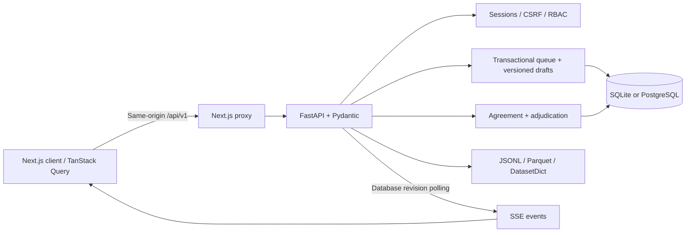

# Concord

**Better data, built together.** A full-stack annotation and quality-control workspace for small teams, built with Next.js and FastAPI.

Concord turns independent human judgments into reviewable datasets. Teams can rate responses, mark token-aligned entities, or compare blinded A/B responses. Reviewers get live agreement metrics, a disagreement queue, and traceable final decisions.



## Project website

Visit the [portfolio website](https://acespades10.github.io/Concord/) or
[live annotation app](https://concord-acespades10.onrender.com/). The app requires
a provisioned account and may take a minute to wake on its free hosting plan.
See the [public release verification](docs/public-release.md) for deployment checks.

The [static website](site/README.md) presents the product, a recorded annotation
workflow, downloadable validated exports and the evidence behind the benchmark.
Preview it with `python -m http.server 8080 --directory site`. The GitHub Pages
workflow validates and publishes the site from this public repository.
See the site guide for deployment details.

## Reproduce the annotation benchmark

The [sample project](benchmarks/README.md) runs dataset import, assignment, 90
**simulated annotations**, review, and independently validated JSONL export against
Concord's real API. It uses 30 original SMS messages with source labels and a
checksum-pinned, CC BY 4.0 licensed dataset. No running server is required.

```sh
uv sync --project apps/api --extra dev --frozen
uv run --project apps/api --extra dev --frozen python benchmarks/run.py --output .local/benchmark
```

The benchmark includes 10 disagreements and 5 unanimously wrong controls. A
separate reference implementation checks the agreement metrics, and a standalone
Python process checks the exported IDs, text, labels, metadata, and submissions.
The output directory contains the reports, exports, and an inspectable SQLite
project. Use a new output directory for each run. These are scripted workflow
checks, not evidence of human agreement, usability, adoption, or model accuracy.

## Try it locally

Requires **Node 24**, **pnpm 11.19.0**, and **uv**. uv installs the pinned Python 3.12 runtime. SQLite is the default; no database server or Docker is needed.

```sh
corepack enable
pnpm install --frozen-lockfile
pnpm setup
pnpm dev
```

Open [localhost:3000](http://localhost:3000). Interactive API documentation is at [localhost:8000/api/v1/docs](http://localhost:8000/api/v1/docs).

For local development, enter one of these seeded accounts manually. All demo accounts use `concord-demo-2026`:

| Account                   | Role      | What to explore                                                        |
| ------------------------- | --------- | ---------------------------------------------------------------------- |
| `admin@concord.demo`      | Admin     | Create projects, import data, assign members, activate, review, export |
| `reviewer@concord.demo`   | Reviewer  | Agreement dashboards, side-by-side adjudication, exports               |
| `annotator1@concord.demo` | Annotator | Sam Rivera’s independent queue                                         |
| `annotator2@concord.demo` | Annotator | Taylor Chen’s independent queue                                        |
| `annotator3@concord.demo` | Annotator | Casey Park’s independent queue                                         |

Seeding is explicit and idempotent. It creates one active project per mode, three annotators per project, and a mixture of completed and unclaimed items. Existing projects, annotations, and account passwords are preserved on subsequent seed runs.

To override native configuration, copy [.env.example](.env.example) to `apps/api/.env`. The default browser origin is **http://localhost:3000**; use that hostname rather than `127.0.0.1` because mutation origins are validated. `API_URL` in `apps/web/.env.local` can override the server-side API proxy target, which defaults to `http://127.0.0.1:8000`.

## A five-minute walkthrough

1. Sign in as **admin**. Open the seeded Response quality project and inspect its quality report, or create a new draft project.
2. For a new project, open **Project setup**, select the three annotators, save the team, and import the matching file from [examples](examples). Activation requires imported items and enough members.
3. Activate the project. Sign in as each annotator in a separate browser profile or sequentially using Sign out. Open the project and start annotating.
4. Open a separate reviewer session. The quality dashboard updates after each submission. At the default 80% threshold with three raters, a two-to-one vote needs review.
5. Open **Review queue**, compare submissions, and save a final decision with a rationale. Download JSONL, Parquet, or a Hugging Face DatasetDict archive from **Export dataset**.

## What is implemented

- Responsive, keyboard-accessible workspace, login, project setup, three annotation editors, quality reports, adjudication, exports, and a field guide.
- Configurable categorical or ordered rating labels; non-overlapping NER spans; randomized, blinded A/B assignments with A/B/TIE choices.
- Argon2id passwords, opaque HTTP-only session cookies, hashed session tokens at rest, expiration, session rotation at login, CSRF tokens, origin validation, and server-enforced role permissions.
- Atomic UTF-8 JSONL/CSV import with row-level errors, duplicate detection, metadata preservation, and persisted Unicode token offsets.
- Transactional shared queue, renewable 15-minute leases, draft autosave with optimistic version checks, skipping/revisiting, and immutable submitted annotations.
- Completion coverage, category distributions, per-item consensus, Fleiss’ kappa, pairwise Cohen’s kappa, and exact-span micro F1 for NER.
- Database-backed metric revisions and cookie-authenticated SSE. Review dashboards poll as a fallback if their stream disconnects.
- Deterministic raw/consensus exports, versioned manifests, canonical A/B identity, stable pseudonymous UUIDs, and explicit unresolved inclusion.
- Alembic migrations, checked-in OpenAPI and generated TypeScript types, lockfiles, Docker images, Compose, and CI.

## Architecture



```text
apps/
  api/
    app/           auth, models, contracts, queue, metrics, exports, seed
    migrations/    versioned schema, async SQLite/PostgreSQL migration runner
    tests/         mathematical, integration, concurrency, export round-trip tests
    openapi.json   checked-in source contract
    uv.lock
  web/
    src/app/       App Router pages and layouts
    src/components/ editors, reports, accessible Radix/shadcn-style primitives
    src/lib/       generated API types, fetch client, shared helpers
    tests/         React component tests
    e2e/           multi-role Playwright workflows and axe accessibility audit
examples/          sample imports for all modes
docs/              design notes and screenshots
```

### Queue consistency

Every project mutation first updates a project lock counter inside its transaction. This acquires a row lock on PostgreSQL and a writer lock on SQLite. Allocation then counts submitted annotations plus live, unskipped claims. A uniqueness constraint prevents duplicate item/user assignments and annotations. A user has at most one live assignment per project through the serialized allocator.

Expired drafts remain recoverable if the allocator can reclaim a slot for that annotator; otherwise another annotator can finish the item. Each renewal increments the version. Saves, submissions, and skips reject expired claims. Draft autosaves renew the lease, and the client serializes saves so submission uses the latest version. A conflict locks the editor until reloaded.

This favors correctness and understandable behavior for small teams. SQLite serializes writes across the database; PostgreSQL permits different projects to write concurrently. There is no external message broker or in-process-only queue.

### Project lifecycle and roles

`draft → active → completed → archived`, with direct archiving from draft or active also allowed. Activation locks mode, labels, target rater count, and threshold. Imports happen only in draft. Completion requires full target coverage. Active/completed projects can be adjudicated; archived projects remain readable and exportable.

Admins manage configuration and membership. Reviewers have workspace-wide review/export access. Annotators require project membership and cannot access metrics, other users’ submissions, review, membership listings, or exports. Removing a member invalidates their live claims but preserves submitted work. Membership is editable in draft/active projects.

## Data and agreement contracts

All routes are under `/api/v1`. Full schemas are in [OpenAPI](apps/api/openapi.json), with endpoint summaries in [docs/api.md](docs/api.md).

Annotation writes use a discriminated envelope; `version` comes from the current assignment:

```json
{"mode":"rating","payload":{"label":"Excellent","note":"Clear and actionable."},"version":0}
{"mode":"ab","payload":{"choice":"A","note":"More specific."},"version":0}
{"mode":"ner","payload":{"spans":[{"start":0,"end":4,"label":"PERSON","text":"Maya"}]},"version":0}
```

Adjudications reuse `mode` and `payload`, adding `rationale`. Reviewer identity is taken from the authenticated session.

- **NER offsets:** Unicode code points, half-open `[start, end)`. Tokenization uses Unicode word sequences or individual non-whitespace punctuation/symbols. JavaScript uses `Array.from(text)` when slicing. Spans must match stored token boundaries and original text. Nested/overlapping spans are rejected. Empty spans are valid.
- **A/B identity:** display sides are independently randomized per assignment and stable on resume. Drafts and submissions normalize to canonical A/B at the API boundary. Metadata is hidden from annotator item responses. Reviews and exports use canonical response identities.
- **Fleiss’ kappa:** only complete items at the target rater count; NER expands complete items into BIO token rows. Partial coverage is excluded. Rating order is preserved in configuration, while kappa remains unweighted categorical agreement.
- **Cohen’s kappa:** only shared categorical items or shared NER BIO token labels for each pair.
- **Exact-span F1:** micro-aggregates matching `(item, start, end, label)` tuples for shared NER items. Two empty span sets score 1; one empty set scores 0. No shared items returns null.
- **Consensus:** strict majority plus configured threshold after target coverage. A/B TIE is an ordinary category; a tied _vote_ is unresolved. NER chooses exact majority spans and checks support for every resulting BIO token including `O`; minimum support is the item’s vote share. This flags minority entities and ambiguous boundaries rather than silently dropping them. Adjudication overrides consensus without rewriting submissions.
- **Undefined scores:** `{ "value": null, "reason": "zero_expected_disagreement", "n": 6 }`, or an explicit missing-coverage reason. Never NaN.

## Exports

Select `annotations`, `consensus`, or `both`. Raw means **submitted annotations**; drafts are excluded. Raw exports work before completion. Consensus defaults to resolved items; `include_unresolved=true` adds explicit unresolved records.

| Format       | Single selection                          | Both selections                               | Manifest                                                                        |
| ------------ | ----------------------------------------- | --------------------------------------------- | ------------------------------------------------------------------------------- |
| JSONL        | Direct `.jsonl`                           | ZIP with two JSONL files                      | First `_manifest` record; archive also contains `manifest.json`                 |
| Parquet      | Direct `.parquet`                         | ZIP with two Parquet files                    | `concord.manifest` Arrow schema metadata; archive also contains `manifest.json` |
| Hugging Face | ZIP containing selected DatasetDict split | ZIP with `annotations` and `consensus` splits | Archive `manifest.json`                                                         |

Rows sort by external ID, then pseudonymous annotator UUID. Archives use fixed ZIP entry timestamps. Arbitrary imported metadata is preserved losslessly in `metadata_json`, avoiding incompatible nested Arrow types between rows. Payloads and NER tokens/spans remain nested, typed structures in Parquet and Hugging Face. Absent mode-specific Arrow fields are null. The manifest preserves project configuration, revision, offset units, schema version, row counts, and export policy.

```python
import json
from datasets import load_from_disk
import pyarrow.parquet as pq

# After extracting a Hugging Face archive:
dataset = load_from_disk("export/dataset")
print(dataset["annotations"][0]["payload"])

# A JSONL download begins with a manifest record:
with open("annotations.jsonl", encoding="utf-8") as file:
    manifest = json.loads(next(file))["_manifest"]
    rows = [json.loads(line) for line in file]

table = pq.read_table("annotations.parquet")
manifest = json.loads(table.schema.metadata[b"concord.manifest"])
```

## Development and verification

| Command                                                       | Purpose                                                |
| ------------------------------------------------------------- | ------------------------------------------------------ |
| `pnpm dev`                                                    | Run both services                                      |
| `pnpm dev:api` / `pnpm dev:web`                               | Run either service                                     |
| `pnpm db:migrate`                                             | Apply migrations                                       |
| `pnpm db:seed`                                                | Idempotent demo seed                                   |
| `pnpm api:types`                                              | Regenerate OpenAPI and frontend types                  |
| `pnpm lint` / `pnpm format:check`                             | ESLint, Ruff, Prettier                                 |
| `pnpm typecheck`                                              | TypeScript contract/UI checks                          |
| `pnpm test`                                                   | Component and backend tests                            |
| `pnpm build`                                                  | Next.js production build                               |
| `pnpm --filter @concord/web exec playwright install chromium` | Install browser test runtime                           |
| `pnpm test:e2e`                                               | Accessibility, mobile layout, and multi-role workflows |

Run `pnpm setup` before end-to-end tests. Playwright starts services if needed and reuses local development servers. Test-created projects have `E2E` names and remain available for inspection. Backend tests use isolated temporary SQLite files. Setting `TEST_DATABASE_URL` runs the same tests against a **dedicated disposable PostgreSQL database**; the test fixture recreates its schema.

CI checks formatting, lint, types, OpenAPI drift, unit/integration/component tests, SQLite migrations, PostgreSQL migrations (upgrade/downgrade), the backend suite against PostgreSQL, production build, browser scenarios, accessibility, and Docker Compose startup. Container/PostgreSQL verification requires a Docker-enabled runner; no local Docker installation is assumed.

## Docker Compose

On a Docker-enabled machine:

```sh
docker compose up --build -d
docker compose logs -f
```

Open [localhost:3000](http://localhost:3000). Compose starts PostgreSQL, applies migrations, then starts the API and web services. Demo seeding is an explicit optional step: `docker compose run --rm migrate python -m app.seed`. PostgreSQL data persists in a named volume. API/database ports stay internal; the web service binds only to loopback and proxies API requests. Both runtime containers run as non-root users.

This Compose configuration is for local development. Use the [production guide](docs/production.md) for free Render/Neon hosting or `compose.production.yaml` with automatic HTTPS. Production validates secure settings, refuses demo seeding and demo logins, and uses persistent login rate limits. The account CLI provisions real users and rotates passwords with session revocation. `API_URL` is a web image build argument because Next.js rewrites are evaluated during the build.

## Scope and tradeoffs

This is a portfolio MVP for one workspace and small teams. Registration, invitations, self-service password reset, billing, nested NER, annotation revision history, and Hugging Face Hub publishing are out of scope. Skips persist per annotator until explicitly revisited. Adjudication updates replace the prior decision; submitted annotations never change. Metrics and exports are computed in memory, so large corpora would need pagination, background export jobs, and incremental aggregation. Sessions have a fixed 24-hour lifetime. Database-backed login limits are shared across workers; larger deployments should supplement them with provider/WAF controls.

## License

Concord's original code and documentation are [MIT licensed](LICENSE). The SMS
dataset and bundled font retain their own licenses; see [third-party notices](THIRD_PARTY_NOTICES.md).

The visual system uses warm neutrals, restrained sage accents, and mode-specific colors, with reduced-motion support and responsive layouts. It uses system fonts and CSS artwork, so local development does not depend on a font or image CDN.
